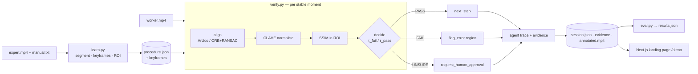

<div align="center">
  
  <h1>USTAAD</h1>
  <p><strong>Learn a procedure once. Verify it every time.</strong></p>
  <p>OpenCV 5 · mathematical vision · deterministic agent trace · AWS-ready</p>
</div>

<div align="center">


</div>

USTAAD is a vision system for physical procedures. It learns a task from one
expert demonstration and a short manual, then verifies each worker step with
alignment, region comparison, and an auditable agent action.

USTAAD learns a physical procedure from **one** expert video plus a short text
manual, then watches a worker's video and verifies each step. An agent acts on
every vision result:

- **PASS** → `next_step`
- **FAIL** → `flag_error(region)`
- **UNSURE** → `request_human_approval`

Built for the **OpenCV AI Competition 2026** on **OpenCV 5** + **AWS**.

> **Important:** the public demo is simulated. The control panel, worker hand,
> camera noise, lighting drift, and failure case are procedurally generated.
> Evaluation uses a procedurally generated scene; real-factory validation is
> the next step.

## Start here: the landing page is the demo

The project is intentionally demoable without a camera, factory footage, AWS
credentials, or generated video files. Start the web app and open the landing
page: it immediately runs an honest browser simulation of the control cell,
agent trace, OpenCV decision stages, and synthetic-data results state.

```bash
# Windows PowerShell
cd D:\opencvfactory\web
npm install
npm run dev
# open http://localhost:3000
```

```bash
# macOS / Linux
cd web
npm install
npm run dev
# open http://localhost:3000
```

The first screen is already a complete simulation. Scroll below the hero for
the before/after valve correction, mathematical model, agent trace, and the
interactive five-step lab. In the lab, click **Load 5-step example**, switch
to **Verify**, and press **Reset & run**.

The yellow **Start simulation** control jumps directly into the interactive
lab. The visual language is inspired by the open-source [Anatomy project](https://github.com/wheresryan22/anatomy): a light technical figure, precise parts, calm motion, live readouts, and one model driving the visual state. USTAAD’s figure is original and uses no copied assets.

For the complete offline OpenCV 5 replay, run `bash pipeline/run_all.sh` on
Linux. The generated `/demo` artifacts automatically replace the browser
fallbacks on the next page load.



## What the visitor sees

1. **Instrumented replay** — an isometric control cell with camera markers,
   ROI, scanline, stage counter, and live verdict.
2. **Before → after simulation** — a wrong valve state, `FAIL`, region flag,
   correction, and re-verification to `PASS`.
3. **Mathematical model** — motion energy, homography, SSIM, and deterministic
   thresholds shown beside the visual result.
4. **Learn / verify / decision figures** — the pipeline explained as a visual
   scientific narrative.
5. **Live lab** — capture or load a procedure, drag an ROI, verify stable
   moments, and approve/reject uncertain results in-browser.

## What's here

```
pipeline/        OpenCV 5 pipeline (reusable package + CLIs)
  ustaad/        config · video · segment · align · compare · agent · engine
  learn.py verify.py eval.py make_synthetic.py run_all.sh
  tests/         pytest on synthetic images
api/             FastAPI over the pipeline (/health /verify /process)
web/             Next.js landing page (the main deliverable)
infra/DEPLOY.md  exact AWS deploy commands (EC2 · Caddy · S3 · CloudWatch)
docs/REPORT.md   technical report
Dockerfile docker-compose.yml
```

The demo uses a procedurally generated scene; real-factory validation is the next
step. The pipeline also accepts a real recording set with no code changes. The
web app loads everything from `/demo/`, so swapping in a new recording is just
re-running `run_all.sh`.

## Pinned dependencies

| Component | Pin |
|-----------|-----|
| OpenCV | `opencv-contrib-python-headless==5.0.0.93` |
| NumPy | `numpy<2.3` |
| FastAPI / Uvicorn | `0.115.2` / `0.31.1` |
| Next.js / React | `14.2.15` / `18.3.1` |
| framer-motion / Tailwind | `11.3.19` / `3.4.10` |

## Run the pipeline

> **Windows note:** Smart App Control blocks the unsigned OpenCV native DLL on
> native Windows. Run the pipeline under **WSL2**, Linux, or Docker. The web app
> and the API build fine everywhere.

```bash
# full pipeline: synthetic data (if none) → learn → verify → eval → publish to web
bash pipeline/run_all.sh
```

Individually:

```bash
python pipeline/make_synthetic.py        # generate data/ stand-ins
python pipeline/learn.py                  # → out/procedure.json + keyframes
python pipeline/verify.py                 # → out/session.json + evidence + annotated.mp4
python pipeline/eval.py                   # → out/results.json
```

## Tests

```bash
pip install -r pipeline/requirements.txt
pytest pipeline/tests -q
```

## Web app

```bash
cd web
npm install
npm run dev       # http://localhost:3000
npm run build     # static export → web/out/
```

Set `NEXT_PUBLIC_API_URL` to route the live lab's verification through the API;
otherwise it uses the in-browser fallback (shown by a chip on the stage).

## API

```bash
pip install -r api/requirements.txt
uvicorn api.main:app --reload --port 8000
# or: docker compose up --build
curl localhost:8000/health
```

## Deploy

See [`infra/DEPLOY.md`](infra/DEPLOY.md) for copy-paste commands: a t3.small EC2
running the container behind Caddy (automatic HTTPS), an IAM role scoped to one
S3 bucket, the Next.js static export on S3 website hosting, and container logs to
CloudWatch via the Docker `awslogs` driver.

## Responsible use

USTAAD supports workers; it does not surveil them. It verifies the task, never
scores the person. Deployments require worker consent, and every uncertain result
escalates to a human rather than being decided silently.
